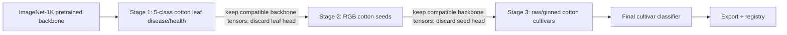
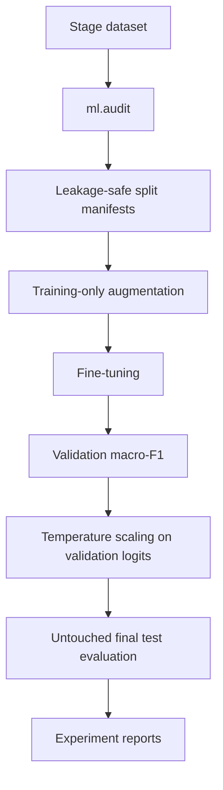
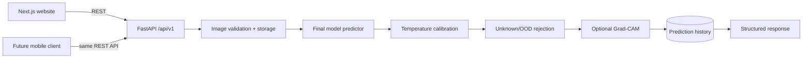

# Cotton Grade Architecture

Cotton Grade has two deliberately separate concerns:

1. **Research/training lineage** — ImageNet → cotton leaves → cotton seeds → final raw-cotton cultivar model.
2. **Production inference** — one final trained model served through FastAPI to the web client and future mobile clients.

The intermediate leaf and seed classifiers are never required at runtime.

## 1. Research architecture



Primary research backbone: `convnext_tiny`.

Controlled routes:

```text
baseline       ImageNet → Final
leaf_to_final  ImageNet → Leaves → Final
seed_to_final  ImageNet → Seeds → Final
progressive    ImageNet → Leaves → Seeds → Final
```

All routes share the exact same final split manifests under `data/processed/splits/final/`.

### Checkpoint transfer

`ml.models.factory.load_transfer_weights()` loads only tensors whose key **and shape** match the new task model. Because the target model is created with the new dataset's class count first, an old classifier head is naturally excluded when its shape differs.

Each final checkpoint records lineage metadata:

```json
{
  "lineage": {
    "transfer_source": "...previous checkpoint...",
    "init_checkpoint": "...",
    "transfer": {
      "loaded_tensors": 0,
      "skipped_tensors": 0,
      "source_classes": []
    }
  }
}
```

Exports and registry entries preserve that lineage.

## 2. Dataset architecture

```text
data/stages/
├── leaf/   # Cotton Leaf Image Dataset for Disease Classification
├── seed/   # 450-image Cotton Seed Quality public evaluation set
└── final/  # raw/ginned cotton cultivar dataset
```

Every stage is audited independently. The final stage should use `metadata.csv` with `sample_id` whenever multiple images originate from one physical cotton specimen.



Augmentations are applied only after split assignment. The final test set is not used for early stopping, calibration, threshold selection or model selection.

## 3. Experiment/result architecture

`ml.progressive` orchestrates the controlled routes. Final-task outputs use predictable report directories:

```text
reports/transfer_baseline/
reports/transfer_leaf_to_final/
reports/transfer_seed_to_final/
reports/transfer_progressive/
```

FastAPI exposes read-only research endpoints:

```text
GET /api/v1/research
GET /api/v1/research/experiments
```

The experiments endpoint reads real report files. If they do not exist, metrics are `null` and status is `pending`. The frontend never invents research results.

## 4. Production inference architecture



Production serving does **not** call the leaf model or seed model. It loads only the active final artifact from the model registry once during FastAPI startup.

## 5. Repository responsibilities

| Area | Responsibility |
|---|---|
| `src/` | Next.js research + product website |
| `backend/app/` | FastAPI, persistence, validation, storage, research/result APIs |
| `ml/` | datasets, splits, training, progressive transfer, evaluation, calibration, OOD, Grad-CAM, export |
| `config/research.json` | canonical research question, selected datasets, stage lineage and routes |
| `config/progressive_transfer.yaml` | executable progressive-training plan |
| `models/` | checkpoints, exported artifacts and active registry |
| `reports/` | experiment evidence consumed by the research UI |

## 6. Website architecture

The website is a normal research/product site, not a presentation mode:

```text
/                 introduction
/research         problem + research question
/datasets         selected datasets + integrity rules
/architecture     training + serving architecture
/models/leaf      intermediate model 1
/models/seed      intermediate model 2
/experiments      controlled comparisons and real result ingestion
/analyze          final model + live analyzer
```

Supporting application pages such as history, statistics, docs and about remain available without interrupting the primary research narrative.

## 7. Model registry contract

The registry remains the serving source of truth. A trained final entry contains at least:

- architecture
- checkpoint
- final class names
- input resolution and normalization
- calibration temperature
- OOD configuration
- evaluation metrics
- transfer lineage
- version and git commit

Trained classes come only from the active model artifact/registry. Mock classes remain isolated from trained mode.

## 8. Reproducibility

Every experiment should preserve:

- dataset version/fingerprint
- saved split manifests
- seed
- full training config
- architecture
- source checkpoint and transfer report
- environment versions
- git commit
- calibration output
- final test metrics

See `docs/PROGRESSIVE_TRANSFER.md`, `docs/TRAINING.md` and `docs/EXPERIMENTS.md`.

## 9. Extension points

The architecture remains compatible with:

- DINOv2/ViT comparison experiments
- additional cotton intermediate domains
- Indian cultivar datasets
- cotton-vs-non-cotton gating
- contamination/quality heads
- HVI property regression
- React Native / Flutter clients
- cloud object storage and PostgreSQL deployment

Any added intermediate stage should be evaluated as a controlled experiment rather than assumed beneficial.
